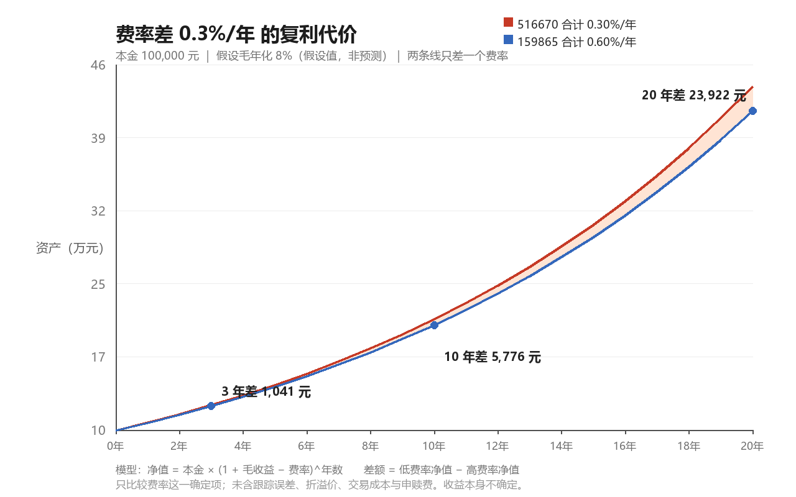

# 学习笔记：指数选样规则 · 费率拖累 · 市盈率（作业批改）

## 我自己的话（费曼检验）

<待你完成复述后回填：用三句话分别解释「为什么中证农业里几乎没有渔业」「0.3% 费率差为什么值得在意」「PE 为负意味着什么」>

## 一、指数选样规则（作业 1）

### 你答对的部分

「名字里有，不代表持仓里有」——这就是核心，你抓住了。指数基金买的不是"名字"，是一张**按规则生成并定期更新的持股清单**。

### 第一步：规则长什么样

一个中证指数从"名字"到"持仓"要过四道闸，缺一道就会理解错：

| 环节 | 规则要点 | 对渔业的影响 |
|---|---|---|
| **样本空间** | 上市时间满一定期限（常见 1 年或一个季度）、非 ST/*ST、非暂停上市、非退市整理 | 渔业里有些标的长期亏损或被风险警示，先被筛掉一批 |
| **选样** | 行业内按**过去一年日均成交额 / 日均总市值**排序，取前 N 名（或按行业归类纳入） | 渔业个股市值 17–45 亿元、日均成交额 0.3–4.6 亿元，排不进前列 |
| **加权** | **自由流通市值加权**（剔除限售股、国有股等不流通部分），部分指数设单只权重上限 | 市值越小，权重越小；即使入选也接近 0 |
| **定期调整** | 通常每半年（6 月/12 月）调整一次，设缓冲区规则减少换手 | 想进指数，得先"长大"过一整个调整周期 |

### 第二步：实测证据（我逐只核对过成分）

| 指数 | 跟踪它的 ETF | 成分数 | 渔业相关个股 | 权重 | 前十大权重合计 |
|---|---|---|---|---|---|
| 中证农业主题 000949 | 159825、512620、516810 | 49 只 | **仅天马科技 1 只** | **0.725%** | 61.5% |
| 中证畜牧养殖 930707 | 159865、516670 | 31 只 | **仅天马科技 1 只** | **1.631%** | 69.7% |

> 天马科技是"特种水产饲料 + 鳗鱼养殖"，被归到饲料/农业链，所以能进；真正的纯渔业（中水渔业、獐子岛、好当家、大湖股份、国联水产、东方海洋、佳沃食品、百洋股份、开创国际）**一只都不在成分里**。

两个数字是这次最该记住的：

1. **0.725% 的权重，意味着这只股票涨 20%，对指数只贡献 0.145 个百分点。** ——"成分里有"和"你能从指数里获得这个暴露"是两件事。
2. **前十大占 61.5% / 69.7%** —— 你买的 159825 实质上更接近"猪周期 + 饲料"基金，而不是"农业"基金。名字是分类，权重才是暴露。

### 第三步：了解规则有什么用（这才是你问的重点）

1. **判断你真正买到了什么**：绕开名字，直接看成分与权重，才知道自己的风险落在哪。
2. **预判集中度风险**：前十大 60%+ 意味着"行业分散"是假的，实际是少数几家公司决定净值。
3. **预判调仓带来的买卖盘**：成分调整生效日，被动资金必须跟买跟卖——这是可预期的资金流（也是一个可研究的现象）。
4. **避免把个股走势当板块走势**：百洋股份 3 个月 +135%，但它在指数里可能根本没有权重，所以"板块涨了"和"这只票涨了"是两句话。

### 常见误区

- ❌ 基金名字 = 持仓内容 → ✅ 名字只是分类标签，成分表才是内容
- ❌ 进了成分 = 有意义的暴露 → ✅ 要看权重，0.7% 约等于没有
- ❌ 全指 = 全覆盖 → ✅ "全指"指覆盖范围的选样空间宽，不是"每只都平均买"

## 二、费率拖累（作业 2）

### 公式（你猜得对，确实有公式）

单利直觉版（适合口算）：

```
多年费率差 ≈ 本金 × 年费率差 × 年数
例：100,000 × 0.3% × 3 = 900 元
```

复利精确版（实际发生的是这个）：

```
净值(t) = 本金 × (1 + 毛收益 − 费率)^t
差额(t) = 净值_低费率(t) − 净值_高费率(t)
```

### 实测结果（本金 10 万，假设毛年化 8%，仅为假设）

| 持有年限 | 0.30%/年（516670） | 0.60%/年（159865） | 差额 | 占终值比例 |
|---|---|---|---|---|
| 1 年 | 107,700 | 107,400 | 300 元 | 0.28% |
| 3 年 | 124,924 | 123,883 | **1,041 元** | 0.84% |
| 5 年 | 144,903 | 142,896 | 2,007 元 | 1.40% |
| 10 年 | 209,970 | 204,194 | **5,776 元** | 2.83% |
| 20 年 | 440,874 | 416,952 | **23,922 元** | 5.74% |



### 三个关键理解

1. **差额不是线性的**。单利算 20 年是 6,000 元，复利实际是 23,922 元——差 4 倍。因为省下的费也会继续赚钱。
2. **费率是"确定项"，收益是"不确定项"。** 你能控制的只有前者；这也是为什么很多专业机构把费率当作唯一可预测的 alpha。
3. **但低费率不是买入理由。** 516670 费率只有 159865 的一半，可它日成交额 0.23 亿 vs 1.32 亿——**冲击成本**可能吃掉省下的费。费率是必要条件，不是充分条件。

## 三、市盈率 PE（作业 3）

### 直觉解释

**PE = 市值 ÷ 净利润 = 股价 ÷ 每股收益(EPS)。**
人话：**假设利润一分不变、全部归你，多少年回本。**

- PE = 10 → 10 年回本，等价于年回报 10%
- PE = 20 → 20 年回本，等价于年回报 5%
- 所以 **盈利收益率 = 1/PE**，这是把 PE 换算成"利率"的钥匙

### 三个版本，别混用

| 版本 | 分母 | 特点 |
|---|---|---|
| 静态 PE（LYR） | 上一个完整年度净利 | 最滞后，已过时 |
| **滚动 PE（TTM）** | 最近 4 个季度净利 | **最常用**，行情软件默认多是它 |
| 动态 PE | 分析师预测下一年净利 | 最前瞻，但也最"预测" |

### PE 为负是什么意思

净利润为负 → PE 为负或在软件里显示"—"。**这时 PE 失去意义，不能比较"谁更便宜"**，要换指标：PB（家底）、PS（营收）、EV/EBITDA、经营性现金流。

回到渔业：10 只样本里 5 只 PE 为负，说明这个板块里一半公司在亏钱——**"板块便宜不便宜"在 PE 口径下根本无从谈起**。

### 批改你的答案

你说：**「上涨的可证伪理由，那应该是市场行情变好，企业营收上涨」**

**对的部分（占一半）**：你把"上涨"和"企业赚钱"联系起来了，方向是对的。价格长期由盈利支撑，这是基本面分析的起点。

**需要纠正的两点**：

1. **「市场行情变好」是循环论证。** 我们要解释的正是"行情为什么变好"，不能用它当理由。这在逻辑上叫把结论当前提。
2. **你把"原因"写成了"证伪条件"。** 证伪不是"什么导致上涨"，而是**「看到什么，我就承认自己这次看错了」**。前者是对未来的猜测，后者是可检验的承诺——后者才逼你说出具体数字。

### 可证伪理由的正确写法

公式：**「若（时间）内出现（可观察指标）达到（阈值），则我的判断被证明/被推翻」**

以百洋股份（PE 为负、1 个月 +72%）为例：

> 若 2026 年报或 2027Q1 报显示**扣非净利同比转正**，且同期**鱼粉/豆粕成本同比回落**，则这轮上涨是"盈利反转"，我的"纯题材"判断被推翻；
> 若营收增长但**毛利率仍为负**、**经营性现金流转负**，则上涨只是估值/情绪推动，判断成立。

注意它具备三个要素：**具体指标**（扣非净利、毛利率、现金流）、**阈值方向**（转正/为负）、**时间窗**（2026 年报 / 2027Q1）。缺一个都不叫可证伪。

## 四、这个 Skill 是怎么得出结论的（元问题）

### 五个动作，按顺序

1. **拆问题**：核心变量是什么？时间窗口多长？有没有真金白银在交易这个结果（可定价性）？
2. **选信号**：至少 3 个**独立维度**。独立性指"不同市场对同一件事各自定价"，不是同一件事取三次。
3. **路由三问**（过滤掉噪声）：相关性？时间尺度匹配？有没有信息增量？
4. **矛盾推理**（结论质量全在这一步）：先找共振（同向的信号合起来说什么），再找**分歧**（谁跟谁不一致，为什么可以同时成立），最后按时间尺度分层。
5. **结构化输出 + 落盘**：数值 → 含义 → 概率/情景 → 触发条件 → 免责。

### 主要看什么数据（每一行都对应"它在说什么"）

| 数据 | 它在替你回答什么 | 我们的取数命令 |
|---|---|---|
| 预测市场概率 | 愿意下注的人合计认为概率多大 | `--signals '{"pm":{"type":"polymarket","query":"..."}}'` |
| 期限利差（10Y-2Y） | 长钱比短钱更悲观吗（衰退信号） | `{"type":"akshare_bond"}` |
| 隐含波动率 / put-call | 不确定性被定价得多贵 | `--preset options` |
| 期货基差（contango/back） | 杠杆需求还在不在 | `{"type":"deribit_futures"}` |
| 涨跌幅拆单（主力/散户） | 谁在买（同样 K 线，两种含义） | 东财（当前被封）／同花顺净额替代 |
| 恐贪指数 | 情绪在周期哪个位置 | `{"type":"fear_greed"}` |
| 估值分位 | 现在贵不贵（相对自己的历史） | `--preset a-share` / AKShare 估值 |
| 商品价格比价（铜/金） | 工业需求 vs 避险需求谁更强 | `{"type":"akshare_foreign","symbol":"HG"}` |

### 你自己怎么分析（最小可行流程）

不需要一次上齐所有数据。从这三步开始就能形成闭环：

```
第 1 步：把问题写成可证伪句（指标 + 阈值 + 时间）
第 2 步：找 3 个不同市场的价格（≥1 个"真金白银"的，如资金流/期权/预测市场）
第 3 步：写下「若 X 出现则我错了」，放进 notes/analysis/，每月复盘时核对
```

**判断你是否真的完成了一次分析：** 一个月后回看，你能不能明确说"这条被验证了/这条被推翻了"。说不出来，就只是写了一篇感想。

## 自测问题（下节课先答这些，再讲新内容）

1. 一只股票在指数里权重 0.7%，它涨 50% 会让指数涨多少？为什么"进了成分"不等于"有暴露"？
2. 用单利和复利分别算：10 万本金、费率差 0.3%、20 年，差多少？为什么两者差这么多？
3. PE = 5 的银行股和 PE = 50 的科技股，哪个"回本更快"？这个比较成立的前提是什么？
4. 把"我觉得百洋股份涨太多了"改写成一句可证伪的话（要有指标、阈值、时间）。

## 小作业

- [ ] 在 `--preset a-share` 之外，用 `python scripts/oracle_signals.py --signals '{"pm":{"type":"polymarket","query":"recession","limit":5}}'` 取一次预测市场概率，把「问题 / 概率 / 成交量」抄进笔记，并判断这个合约流动性够不够看
- [ ] 挑一只你在京东金融持有的基金，查它的跟踪指数成分（前十大 + 权重），写下"我实际买到的暴露是什么"
- [ ] 把今天这张费率图换成你自己的两个候选基金（改脚本里的两个费率），重新算一遍

## 与已学概念的联系

- 指数选样 → 呼应「能力圈」：你买的东西要能说清它是什么
- 费率拖累 → 呼应「复利」：复利对成本同样有效，方向相反
- PE → 呼应 `notes/lessons/2026-09-07-估值基础术语包.md` 里的「盈利收益率 = 1/PE」，那篇已经埋了这一层
- 可证伪 → 呼应「情景推演」：不是预测，是提前写好认输条件

---
*数据来源：中证指数官网成分与权重（000949、930707，权重日 2026-09-30，成分日 2026-10-26）；516670/159865 基金档案（天天基金 f10）。费率为年化合计值（管理费+托管费），未含申赎与交易成本；毛年化 8% 为假设值。*
*仅个人学习记录，不构成投资建议。*
